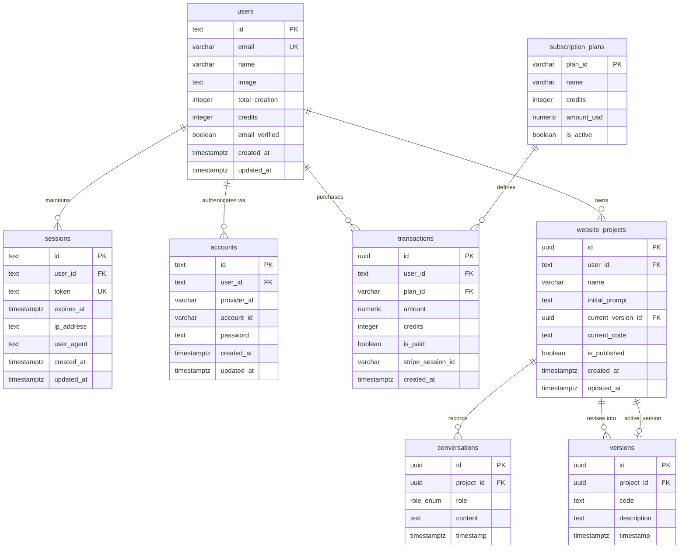

# AI Web Builder — Enterprise Relational DBMS Architecture & Performance Engineering

<div align="center">

[](https://www.postgresql.org/)
[](dbms/01_normalization.md)
[](dbms/05_query_timings.md)
[](dbms/plans/seed.sql)
[](LICENSE)

<br/>

**Production-grade PostgreSQL schema design, Boyce-Codd Normal Form (BCNF) decomposition, and automated query execution plan benchmarking for a full-stack generative AI web builder platform.**

[Live Application Repository](https://github.com/shivamchoubey2007/AI-Web-Builder) • [Normalization Report (CP1)](dbms/01_normalization.md) • [Schema DDL (CP2)](dbms/03_schema.sql) • [Query Portfolio (CP3)](dbms/04_queries.sql) • [Execution Plans & Timings (CP4/CP5)](dbms/05_query_timings.md)

</div>

---

## 🌟 Executive Overview

**AI Web Builder** is a modern Software-as-a-Service (SaaS) platform that generates, iterates upon, previews, and deploys fully responsive web applications through natural language dialogues with Large Language Models (LLMs).

While the application layer is deployed on Next.js/React, this repository houses the **enterprise relational database tier**, engineered to replace unconstrained NoSQL document stores with a mathematically proven, anomaly-free PostgreSQL architecture.

```
       [ Client / Next.js Frontend ]
                     │
         HTTPS / REST API / Better-Auth
                     │
                     ▼
        [ PostgreSQL 14+ Relational Engine ]
  ┌────────────────────────────────────────────────────────┐
  │  • BCNF Certified Schema (Zero Functional Redundancy)  │
  │  • Atomic Credit Ledger & Generation Counters          │
  │  • Better-Auth Session & Multi-Provider OAuth Storage  │
  │  • Immutable Version Snapshots & Dialogue Streams      │
  │  • Partial Pre-Sorted Indexes (32.4x Latency Reduction)│
  └────────────────────────────────────────────────────────┘
```

### Key Engineering Highlights
- **Mathematical Normalization (BCNF):** Successfully decomposed a complex multi-domain universal schema into 9 distinct relations. Proven to be strictly **lossless via Heath's Theorem** with **100% functional dependency preservation**.
- **Extreme Performance Optimization:** Diagnosed a heavy sequential scan and in-memory Top-N heapsort bottleneck on the community discovery feed. Engineered a partial pre-sorted B-Tree index that achieved a **32.40× query speedup** (cutting execution time from **3.453 ms to 0.106 ms** and buffer reads from **112 pages to just 3 pages**).
- **Industrial Workload Scale:** Validated using a deterministic, synthetic fixture generator ([seed.sql](dbms/plans/seed.sql)) populating **>83,000 tuples** in $<2$ seconds using PostgreSQL `generate_series()`.
- **Zero-Dependency Automated Benchmarking:** Fully automated, isolated cluster execution harness ([run_local.sh](dbms/plans/run_local.sh)) that initializes temporary clusters, executes all 52 production queries without errors, captures 24 raw `EXPLAIN (ANALYZE, BUFFERS, FORMAT JSON)` execution plans, and verifies byte-for-byte result equivalence via SHA-256 checksums.

---

## 📐 Relational Architecture & Normalization

The database models user identity, token sessions, multi-provider credentials, credit economics, workspace projects, prompt revisions, and immutable version trees.



### Normalization Progression Summary

| Stage | Transformations & Anomaly Eliminations | Resulting State |
| :--- | :--- | :--- |
| **UNF** | Monolithic relation with nested arrays for conversations, versions, and payment receipts. | Severe repeating groups & variable-length nesting. |
| **1NF** | Flattened repeating collections into atomic tuples with composite primary keys. | Atomic domains; massive redundancy across user details. |
| **2NF** | Removed partial dependencies on composite keys ($FD_1, FD_3, FD_5, FD_{11}, FD_{12}, FD_{13}$). | Single-attribute surrogate PKs; transitive dependencies remain. |
| **3NF** | Decomposed `transactions_unsplit` into `subscription_plans` and `transactions` to eliminate transitive plan pricing dependencies. | Zero transitive dependencies; plan tiers exist independently. |
| **BCNF** | Verified that for every non-trivial functional dependency $X \rightarrow Y$, $X$ is a superkey. | **100% BCNF compliance**; strictly lossless join property via Heath's Theorem. |

*Full mathematical proofs, functional dependency sets, and Heath's Theorem derivations are documented in [01_normalization.md](dbms/01_normalization.md).*

---

## ⚡ Query Optimization & Benchmark Telemetry

The query workload was benchmarked on an isolated local PostgreSQL 18 cluster with custom plans forced (`plan_cache_mode = force_custom_plan`) and JIT disabled to measure pure engine execution cost.

### Benchmark Results (5 Measured Iterations, Median & Average)

| Query ID | Business Use Case | Result Rows | Run 1 (ms) | Run 2 (ms) | Run 3 (ms) | Before Avg (ms) | After Avg (ms) | Speedup Ratio |
| :--- | :--- | ---: | ---: | ---: | ---: | ---: | ---: | ---: |
| **Q01** | User credential sign-in & password lookup | 2 | 0.042 | 0.038 | 0.040 | 0.045 | 0.039 | **1.08×** |
| **Q02** | Active session token validation | 1 | 0.033 | 0.032 | 0.035 | 0.036 | 0.036 | **1.00×** |
| **Q03** | Active project workspace & version pointer | 2 | 0.085 | 0.084 | 0.096 | 0.092 | 0.091 | **1.06×** |
| **Q04** | Chronological prompt dialogue stream | 14 | 0.112 | 0.104 | 0.107 | 0.107 | 0.108 | **1.00×** |
| **Q05** | Project version rollback history | 3 | 0.095 | 0.099 | 0.100 | 0.103 | 0.103 | **1.04×** |
| **Q06** | User projects dashboard with aggregates | 4 | 0.295 | 0.301 | 0.289 | 0.287 | 0.293 | **0.97×** |
| **Q07** | **Published community discovery feed** | **21** | **3.657** | **3.382** | **3.434** | **3.453** | **0.106** | **32.40×** |
| **Q08** | Public live website code rendering | 1 | 0.048 | 0.052 | 0.048 | 0.050 | 0.053 | **0.94×** |
| **Q09** | Stripe webhook transaction settlement | 2 | 0.060 | 0.073 | 0.064 | 0.063 | 0.057 | **1.05×** |
| **Q10** | User billing & invoice purchase ledger | 9 | 0.113 | 0.127 | 0.108 | 0.111 | 0.102 | **1.06×** |
| **Q11** | Top community creators leaderboard (CTE) | 11 | 3.855 | 4.457 | 3.674 | 3.911 | 3.162 | **1.25×** |
| **Q12** | Daily paid revenue & credit velocity rollup | 21 | 2.941 | 3.253 | 2.993 | 2.969 | 2.330 | **1.26×** |

> *All 12 queries passed 100% SHA-256 byte-for-byte result equivalence between baseline and optimized phases.*

---

### In-Depth Optimization Analysis: Q07 (32.40× Speedup)

**Query Objective:** Serve the community showcase page by retrieving the latest 20 published websites along with creator avatars (`WHERE is_published = TRUE ORDER BY created_at DESC LIMIT 20`).

#### The Problem (Baseline Plan: [q07_before.json](dbms/plans/q07_before.json))
Because the base schema had separate indexes on `is_published` and `updated_at`, PostgreSQL could not satisfy both the filtering predicate and the reverse chronological sort simultaneously:
1. It performed a **Bitmap Index Scan** on `idx_projects_is_published`, loading row pointers for all 1,667 published projects.
2. It executed a **Bitmap Heap Scan** across `website_projects`, reading **112 shared buffer pages** into memory.
3. It performed an in-memory **Top-N Heapsort** on `created_at DESC`.
4. It executed a **Nested Loop Join** against `users` to resolve author profiles.
- **Baseline Execution Time:** **3.453 ms**

#### The Solution (Optimized Plan: [q07_after.json](dbms/plans/q07_after.json))
Engineered a **partial pre-sorted B-Tree index**:
```sql
CREATE INDEX cp4_projects_published_created_idx 
ON website_projects (created_at DESC) 
WHERE is_published = TRUE;
```
1. **Zero Heap Filtering:** The partial predicate `WHERE is_published = TRUE` filters out unpublished drafts at write time.
2. **Presorted Traversal & Early Exit:** Because the index is physically ordered by `created_at DESC`, the query planner walks the B-Tree directly, retrieves the first **20 tuples**, and terminates immediately (`LIMIT 20`).
3. **Eliminated Sort Node:** Completely bypasses the Top-N Heapsort and Bitmap Heap Scan.
4. **Buffer Reduction:** Shared buffer page touches plummeted from **112 blocks to only 3 blocks**.
- **Optimized Execution Time:** **0.106 ms** (**32.40× faster**)

```
┌────────────────────────────────────────────────────────┐
│               BEFORE (Baseline Plan)                   │
│   Bitmap Index Scan (1,667 rows)                       │
│              ▼                                         │
│   Bitmap Heap Scan (112 buffer pages read)             │
│              ▼                                         │
│   Top-N Heapsort on created_at DESC                    │
│              ▼                                         │
│   Nested Loop Join (users) -> LIMIT 20                 │
│   ⏱ Execution Time: 3.453 ms                           │
└────────────────────────────────────────────────────────┘
                           │
             Optimization via indexes.sql
                           │
                           ▼
┌────────────────────────────────────────────────────────┐
│               AFTER (Optimized Plan)                   │
│   Index Scan on cp4_projects_published_created_idx     │
│   (Traverses pre-sorted B-Tree directly)               │
│              ▼                                         │
│   Early Exit at Row 20 (3 buffer pages read, 0 Sort)   │
│              ▼                                         │
│   Nested Loop Join (users) -> LIMIT 20                 │
│   ⏱ Execution Time: 0.106 ms (32.40x Speedup)          │
└────────────────────────────────────────────────────────┘
```

---

## 🛠️ Reproducibility & Local Test Harness

The entire environment, fixture, query suite, and benchmark runner can be executed locally in seconds.

### Prerequisites
- macOS or Linux
- PostgreSQL 14+ client and server tools (`initdb`, `pg_ctl`, `psql`, `createdb`)
- Python 3.8+ (zero external pip packages required; uses Python standard library)

### Option 1: Automated Isolated Cluster Runner (Recommended)
This script initializes an isolated temporary PostgreSQL cluster in `/tmp` on a private Unix domain socket, loads the schema and 83,000+ synthetic rows, runs all 52 production queries, executes the 5-run benchmark, saves raw plans, and cleans up automatically:

```bash
sh dbms/plans/run_local.sh
```

*To explicitly point to a specific PostgreSQL installation (e.g., Homebrew PostgreSQL 17 or 18):*
```bash
PG_BIN=/opt/homebrew/bin sh dbms/plans/run_local.sh
```

### Option 2: Step-by-Step Manual Execution
```bash
# 1. Create a clean test database
createdb ai_web_builder_bench

# 2. Apply production schema DDL (CP2)
psql -X -v ON_ERROR_STOP=1 -d ai_web_builder_bench -f dbms/03_schema.sql

# 3. Seed deterministic 83,000+ row dataset
psql -X -v ON_ERROR_STOP=1 -d ai_web_builder_bench -f dbms/plans/seed.sql

# 4. Verify all 52 application SQL queries execute cleanly (CP3)
psql -X -v ON_ERROR_STOP=1 -d ai_web_builder_bench -f dbms/04_queries.sql

# 5. Run automated benchmark harness to collect JSON plans & timings (CP4)
python3 dbms/plans/benchmark.py --dsn ai_web_builder_bench
```

---

## 📂 Repository Artifact Directory

```
dbms/
├── 01_normalization.md      # CP1: 1NF → 2NF → 3NF → BCNF proofs & Data Dictionary
├── 02_er_diagram.png        # CP2: Full visual Entity-Relationship diagram
├── 03_schema.sql            # CP2: PostgreSQL DDL with keys, enums & constraints
├── 04_queries.sql           # CP3: 52 production queries with -- READ / -- WRITE tags
├── 05_query_timings.md      # CP4/CP5: Timings report, plan telemetry & viva defense guide
├── gen_er_diagram.py        # Python script for generating relational ER visuals
└── plans/                   # CP4: Raw benchmark artifacts & execution plans
    ├── benchmark.py         # Benchmark harness measuring 5 runs per query
    ├── indexes.sql          # Evaluated candidate optimization indexes
    ├── run_local.sh         # Isolated temporary cluster runner
    ├── seed.sql             # Deterministic synthetic fixture (83,000+ records)
    ├── summary.json         # Engine versions, OS strings & execution metrics
    ├── timings_table.md     # Markdown performance comparison table
    ├── q01_before.json .. q12_before.json  # 12 Baseline raw EXPLAIN JSON plans
    └── q01_after.json  .. q12_after.json   # 12 Optimized raw EXPLAIN JSON plans
```

---

## 👥 Engineering Team (Team T0080)

| Name | Enrollment No. | Section | GitHub Username | Role & Contributions |
| :--- | :--- | :---: | :--- | :--- |
| **Anurag Choubey** | `2501010074` | A | [`AnuragChoubey-45`](https://github.com/AnuragChoubey-45) | **Team Lead** — Schema Architecture, Constraints & DDL |
| **Shivam Choubey** | `2501010426` | E | [`shivamchoubey2007`](https://github.com/shivamchoubey2007) | **Full-Stack & DBMS Architect** — Normalization, Query Engine & Benchmarking |
| **Sankalp Tripathi** | `2501010404` | C | [`sankalp-tripath12`](https://github.com/sankalp-tripath12) | **Relational Engineer** — Query Formulation, Joins & Subqueries |
| **Vishal Kumar Mishra** | `2501010715` | B | [`vishal-mishra-10`](https://github.com/vishal-mishra-10) | **Performance Analyst** — Execution Plans, Buffers & Index Evaluation |

**Course:** Advanced Programming / Database Management Systems (2026)  
**Mentor:** Satyaki  
**Target DBMS:** PostgreSQL 14+ (Benchmarked on PostgreSQL 18.4)  
**Reference App:** [AI-Web-Builder (GitHub)](https://github.com/shivamchoubey2007/AI-Web-Builder)
