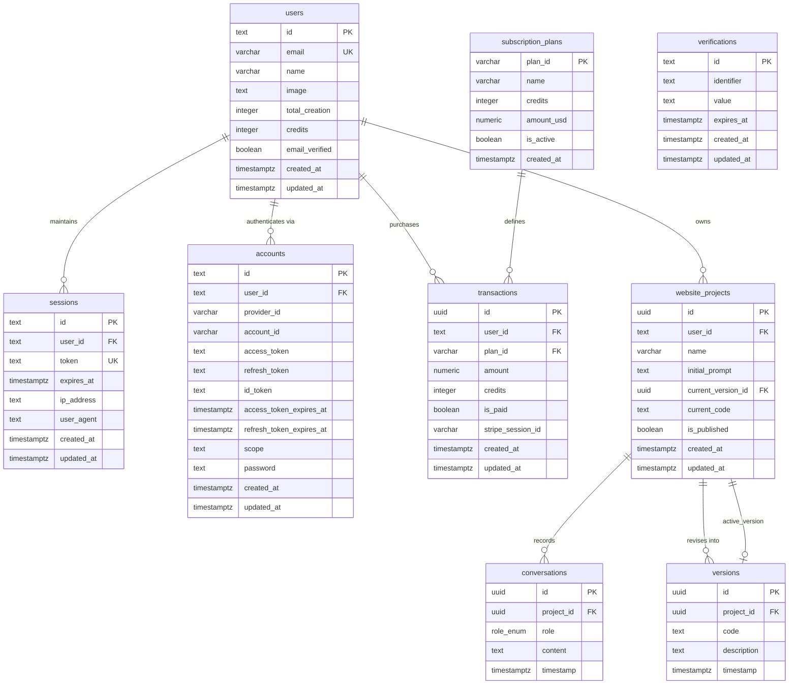

# Normalization Report: AI Web Builder Database
**Project:** AI Web Builder (Full-Stack AI Website Generator & Revision Platform)  
**Team Number:** T0080  
**Section:** A, B, C, E  
**Mentor:** Satyaki  
**Repository (AP):** `shivamchoubey2007/AI_Web_Builder_AP_2026`  
**Reference Application:** `https://github.com/shivamchoubey2007/AI-Web-Builder`  
**Database System:** PostgreSQL 14+  
**Checkpoint:** CP1 — Normalization (1NF → 2NF → 3NF → BCNF)

---

## Team Details

| Name | Enrollment No. | Section | GitHub Username | Role |
| :--- | :--- | :---: | :--- | :--- |
| **Anurag Choubey** | 2501010074 | A | `AnuragChoubey-45` | Team Lead |
| **Shivam Choubey** | 2501010426 | E | `shivamchoubey2007` | Member |
| **Sankalp Tripathi** | 2501010404 | C | `sankalp-tripath12` | Member |
| **Vishal Kumar Mishra** | 2501010715 | B | `vishal-mishra-10` | Member |

---

## 1. Application Overview & Database Objectives

### 1.1 Purpose of the Application
**AI Web Builder** is a modern software-as-a-service (SaaS) application that empowers users to generate, iterate upon, preview, and publish fully responsive web applications using natural language. The architecture integrates:
1. **User Authentication & Identity:** Built using Better-Auth, managing user profiles, session tokens, multi-provider credentials (local email/password and OAuth providers like Google and GitHub), and email verification challenges.
2. **Credits & Monetary Billing:** Users consume credits (5 credits per generation/revision) to invoke LLMs. Credits can be purchased via Stripe checkout sessions under predefined tiers (Basic, Pro, Enterprise).
3. **Project & Workspace Management:** Users create website projects anchored by an initial natural language prompt.
4. **Conversational AI Prompt Engineering & Code Generation:** The platform maintains an interactive dialogue between the user and the assistant, storing prompt refinements, intermediate reasoning steps, and code changes.
5. **Version Control & Rollback Engine:** Every iteration creates an immutable snapshot of generated code (`versions`), allowing users to rollback to any prior state or manually edit the working tree.
6. **Publishing & Public Showcase:** Projects can be toggled between private and public states, enabling community discovery and live rendering.

### 1.2 Motivation for Database Normalization
A naive implementation might store user activity, project data, conversational logs, code revisions, and payment transactions in a single monolithic structure or unstructured JSON blobs. This causes:
- **Redundancy:** Repeating user profiles, authentication tokens, and project metadata across every prompt revision and code version.
- **Insertion Anomalies:** Inability to record a subscription tier or verification token without attaching it to an existing project or conversation.
- **Update Anomalies:** Changing a user's credit balance or email requiring updates across thousands of duplicate records.
- **Deletion Anomalies:** Deleting a failed website draft inadvertently wiping the user's historical credit purchase records or user profile.

The normalization process methodically transforms the universal data model through **1NF → 2NF → 3NF → BCNF**, guaranteeing data integrity, zero unintended data anomalies, and optimal relational storage in PostgreSQL.

---

## 2. Universal Relation & Unnormalized Form (UNF)

### 2.1 Universal Relation Schema
To perform normalization rigorously, we begin with a single **Universal Relation** that encompasses all attributes required by the AI Web Builder application:

$$\begin{aligned}
\text{UNF\_AI\_WEB\_BUILDER} = \{ & \text{user\_id}, \text{email}, \text{name}, \text{image}, \text{total\_creation}, \text{credits}, \text{email\_verified}, \text{user\_created\_at}, \text{user\_updated\_at}, \\
& \text{session\_id}, \text{session\_token}, \text{session\_expires\_at}, \text{ip\_address}, \text{user\_agent}, \\
& \text{account\_id}, \text{provider\_id}, \text{provider\_account\_id}, \text{access\_token}, \text{refresh\_token}, \text{id\_token}, \text{password\_hash}, \dots, \\
& \text{verification\_id}, \text{verification\_identifier}, \text{verification\_value}, \text{verification\_expires\_at}, \\
& \text{project\_id}, \text{project\_name}, \text{initial\_prompt}, \text{current\_code}, \text{current\_version\_id}, \text{is\_published}, \text{project\_created\_at}, \text{project\_updated\_at}, \\
& \{\text{conversation\_id}, \text{role}, \text{message\_content}, \text{message\_timestamp}\}, \\
& \{\text{version\_id}, \text{version\_code}, \text{version\_description}, \text{version\_timestamp}\}, \\
& \{\text{txn\_id}, \text{plan\_id}, \text{plan\_name}, \text{amount}, \text{credits}, \text{amount\_usd}, \text{is\_paid}, \text{stripe\_session\_id}, \text{txn\_created\_at}, \text{txn\_updated\_at}\} \}
\end{aligned}$$

### 2.2 Violations in UNF
- **Repeating Groups:** A single user owns multiple projects; a project contains repeating sets of conversation messages $(\{\text{conversation\_id}, \dots\})$ and version history $(\{\text{version\_id}, \dots\})$; a user performs multiple transactions $(\{\text{txn\_id}, \dots\})$, maintains multiple active sessions, and links multiple OAuth accounts.
- **Non-Atomic Attributes:** Nested records and variable-length collections violate first normal form.

---

## 3. First Normal Form (1NF)

### 3.1 Rule for 1NF
A relation is in **First Normal Form (1NF)** if and only if:
1. Every attribute contains only **atomic (indivisible) values**.
2. There are **no repeating groups or arrays/nested relations**.
3. A unique primary key exists that uniquely identifies every tuple.

### 3.2 Conversion to 1NF (Flattening)
We eliminate repeating groups by flattening the table into atomic rows. In the flattened relation, composite keys are required to uniquely distinguish each row:

$$\begin{aligned}
\text{FLAT\_1NF}( & \underline{\text{user\_id}}, \text{email}, \text{name}, \text{image}, \text{total\_creation}, \text{credits}, \text{email\_verified}, \text{user\_created\_at}, \text{user\_updated\_at}, \\
& \underline{\text{session\_id}}, \text{session\_token}, \text{session\_expires\_at}, \text{ip\_address}, \text{user\_agent}, \\
& \underline{\text{account\_id}}, \text{provider\_id}, \text{provider\_account\_id}, \text{password\_hash}, \dots, \\
& \underline{\text{project\_id}}, \text{project\_name}, \text{initial\_prompt}, \text{current\_code}, \text{current\_version\_id}, \text{is\_published}, \dots, \\
& \underline{\text{conversation\_id}}, \text{role}, \text{message\_content}, \text{message\_timestamp}, \\
& \underline{\text{version\_id}}, \text{version\_code}, \text{version\_description}, \text{version\_timestamp}, \\
& \underline{\text{txn\_id}}, \text{plan\_id}, \text{plan\_name}, \text{amount}, \text{credits\_purchased}, \text{amount\_usd}, \text{is\_paid}, \text{stripe\_session\_id}, \dots )
\end{aligned}$$

Composite Primary Key for the flattened relation:
$$\text{PK} = \{\text{user\_id}, \text{session\_id}, \text{account\_id}, \text{project\_id}, \text{conversation\_id}, \text{version\_id}, \text{txn\_id}\}$$

### 3.3 Functional Dependencies (FDs)
From the domain rules and business logic of the AI Web Builder application:

1. **User Identity & Profile:**
   $$FD_1: \text{user\_id} \rightarrow \text{email}, \text{name}, \text{image}, \text{total\_creation}, \text{credits}, \text{email\_verified}, \text{created\_at}, \text{updated\_at}$$
   $$FD_2: \text{email} \rightarrow \text{user\_id}, \text{name}, \text{image}, \text{total\_creation}, \text{credits}, \text{email\_verified}, \text{created\_at}, \text{updated\_at}$$

2. **Session Management:**
   $$FD_3: \text{session\_id} \rightarrow \text{user\_id}, \text{token}, \text{expires\_at}, \text{ip\_address}, \text{user\_agent}, \text{created\_at}, \text{updated\_at}$$
   $$FD_4: \text{token} \rightarrow \text{session\_id}, \text{user\_id}, \text{expires\_at}, \text{ip\_address}, \text{user\_agent}, \text{created\_at}, \text{updated\_at}$$

3. **External & Credential Accounts:**
   $$FD_5: \text{account\_id} \rightarrow \text{user\_id}, \text{provider\_id}, \text{provider\_account\_id}, \text{access\_token}, \text{refresh\_token}, \text{id\_token}, \text{password\_hash}, \text{created\_at}, \text{updated\_at}$$
   $$FD_6: (\text{provider\_id}, \text{provider\_account\_id}) \rightarrow \text{account\_id}, \text{user\_id}, \dots$$

4. **Security & Email Verifications:**
   $$FD_7: \text{verification\_id} \rightarrow \text{identifier}, \text{value}, \text{expires\_at}, \text{created\_at}, \text{updated\_at}$$
   $$FD_8: (\text{identifier}, \text{value}) \rightarrow \text{verification\_id}, \text{expires\_at}, \dots$$

5. **Subscription Pricing Plans:**
   $$FD_9: \text{plan\_id} \rightarrow \text{name}, \text{credits}, \text{amount\_usd}, \text{is\_active}, \text{created\_at}$$

6. **Billing & Transactions:**
   $$FD_{10}: \text{txn\_id} \rightarrow \text{user\_id}, \text{plan\_id}, \text{amount}, \text{credits}, \text{is\_paid}, \text{stripe\_session\_id}, \text{created\_at}, \text{updated\_at}$$

7. **Website Projects:**
   $$FD_{11}: \text{project\_id} \rightarrow \text{user\_id}, \text{name}, \text{initial\_prompt}, \text{current\_code}, \text{current\_version\_id}, \text{is\_published}, \text{created\_at}, \text{updated\_at}$$

8. **Project Versions (Code Snapshots):**
   $$FD_{12}: \text{version\_id} \rightarrow \text{project\_id}, \text{code}, \text{description}, \text{timestamp}$$

9. **Conversations (Prompt Iterations):**
   $$FD_{13}: \text{conversation\_id} \rightarrow \text{project\_id}, \text{role}, \text{content}, \text{timestamp}$$

### 3.4 Anomalies Remaining in 1NF
- **Redundancy:** Every time a user adds a chat message or creates a code version, their user details (`name`, `email`, `credits`) and project details are duplicated across rows.
- **Update Anomaly:** Updating a user's credit balance requires updating hundreds of rows. Any partial failure creates inconsistent credit balances.
- **Insertion Anomaly:** A new registered user who has not yet created a project, session, or transaction cannot be stored without inserting `NULL`s for prime key attributes, violating the Entity Integrity rule ($\text{PK} \ne \text{NULL}$).
- **Deletion Anomaly:** If a user deletes all their versions or messages, deleting those rows risks deleting the project and user data.

---

## 4. Second Normal Form (2NF)

### 4.1 Rule for 2NF
A relation is in **Second Normal Form (2NF)** if and only if:
1. It is in **1NF**.
2. **No non-prime attribute is partially dependent on any candidate key** (i.e., every non-prime attribute is **fully functionally dependent** on the whole candidate key).

### 4.2 Partial Dependencies in 1NF
In $\text{FLAT\_1NF}$, the candidate key is composite:
$$\{\text{user\_id}, \text{session\_id}, \text{account\_id}, \text{project\_id}, \text{conversation\_id}, \text{version\_id}, \text{txn\_id}\}$$

However:
- $\text{user\_id} \rightarrow \{\text{email}, \text{name}, \text{credits}, \dots\}$ depends only on $\text{user\_id}$ (a proper subset of the key).
- $\text{project\_id} \rightarrow \{\text{name}, \text{initial\_prompt}, \dots\}$ depends only on $\text{project\_id}$.
- $\text{conversation\_id} \rightarrow \{\text{role}, \text{content}, \dots\}$ depends only on $\text{conversation\_id}$.
- $\text{version\_id} \rightarrow \{\text{code}, \text{description}, \dots\}$ depends only on $\text{version\_id}$.
- $\text{txn\_id} \rightarrow \{\text{plan\_id}, \text{amount}, \dots\}$ depends only on $\text{txn\_id}$.
- $\text{session\_id} \rightarrow \{\text{token}, \dots\}$ depends only on $\text{session\_id}$.
- $\text{account\_id} \rightarrow \{\text{provider\_id}, \dots\}$ depends only on $\text{account\_id}$.

### 4.3 2NF Decomposition
We decompose the 1NF relation into distinct relations such that every non-prime attribute depends on the full primary key of its relation:

1. **`users`**
   - **Attributes:** $(\underline{\text{id}}, \text{email}, \text{name}, \text{image}, \text{total\_creation}, \text{credits}, \text{email\_verified}, \text{created\_at}, \text{updated\_at})$
   - **Primary Key:** `id`
   - **FD:** $FD_1, FD_2$

2. **`sessions`**
   - **Attributes:** $(\underline{\text{id}}, \text{user\_id}, \text{token}, \text{expires\_at}, \text{ip\_address}, \text{user\_agent}, \text{created\_at}, \text{updated\_at})$
   - **Primary Key:** `id`
   - **Foreign Key:** $\text{user\_id} \rightarrow \text{users}(\text{id})$
   - **FD:** $FD_3, FD_4$

3. **`accounts`**
   - **Attributes:** $(\underline{\text{id}}, \text{user\_id}, \text{provider\_id}, \text{account\_id}, \text{access\_token}, \text{refresh\_token}, \text{id\_token}, \text{access\_token\_expires\_at}, \text{refresh\_token\_expires\_at}, \text{scope}, \text{password}, \text{created\_at}, \text{updated\_at})$
   - **Primary Key:** `id`
   - **Foreign Key:** $\text{user\_id} \rightarrow \text{users}(\text{id})$
   - **FD:** $FD_5, FD_6$

4. **`verifications`**
   - **Attributes:** $(\underline{\text{id}}, \text{identifier}, \text{value}, \text{expires\_at}, \text{created\_at}, \text{updated\_at})$
   - **Primary Key:** `id`
   - **FD:** $FD_7, FD_8$

5. **`website_projects`**
   - **Attributes:** $(\underline{\text{id}}, \text{user\_id}, \text{name}, \text{initial\_prompt}, \text{current\_code}, \text{current\_version\_id}, \text{is\_published}, \text{created\_at}, \text{updated\_at})$
   - **Primary Key:** `id`
   - **Foreign Key:** $\text{user\_id} \rightarrow \text{users}(\text{id})$
   - **FD:** $FD_{11}$

6. **`conversations`**
   - **Attributes:** $(\underline{\text{id}}, \text{project\_id}, \text{role}, \text{content}, \text{timestamp})$
   - **Primary Key:** `id`
   - **Foreign Key:** $\text{project\_id} \rightarrow \text{website\_projects}(\text{id})$
   - **FD:** $FD_{13}$

7. **`versions`**
   - **Attributes:** $(\underline{\text{id}}, \text{project\_id}, \text{code}, \text{description}, \text{timestamp})$
   - **Primary Key:** `id`
   - **Foreign Key:** $\text{project\_id} \rightarrow \text{website\_projects}(\text{id})$
   - **FD:** $FD_{12}$

8. **`transactions_unsplit`**
   - **Attributes:** $(\underline{\text{id}}, \text{user\_id}, \text{plan\_id}, \text{plan\_name}, \text{amount}, \text{credits}, \text{amount\_usd}, \text{is\_paid}, \text{stripe\_session\_id}, \text{created\_at}, \text{updated\_at})$
   - **Primary Key:** `id`
   - **Foreign Key:** $\text{user\_id} \rightarrow \text{users}(\text{id})$
   - **FD:** $FD_9, FD_{10}$

### 4.4 Status at 2NF
All partial dependencies on composite keys have been eliminated. Every relation has a single-attribute primary key (surrogate UUID/String), guaranteeing that all non-prime attributes are fully dependent on their respective primary key.

---

## 5. Third Normal Form (3NF)

### 5.1 Rule for 3NF
A relation is in **Third Normal Form (3NF)** if and only if:
1. It is in **2NF**.
2. **No non-prime attribute is transitively dependent on any candidate key**.
   *Formally:* For every non-trivial functional dependency $X \rightarrow A$, either:
   - $X$ is a **superkey**, OR
   - $A$ is a **prime attribute** (member of a candidate key).

### 5.2 Analysis of Transitive Dependencies

#### A. Transitive Dependency in Billing:
In `transactions_unsplit`:
$$\text{id} \rightarrow \text{plan\_id} \quad \text{and} \quad \text{plan\_id} \rightarrow \{\text{plan\_name}, \text{amount\_usd}, \text{credits}\}$$
Because $\text{plan\_id}$ is not a candidate key of `transactions_unsplit`, the non-prime attributes $\{\text{plan\_name}, \text{amount\_usd}\}$ are transitively dependent on `id`.

**Anomalies caused by this transitive dependency:**
- **Update Anomaly:** If the price or credit grant for the "pro" plan changes from \$19 (400 credits) to \$25 (500 credits), all historical transaction rows must either be rewritten (corrupting financial audit integrity) or diverge.
- **Insertion Anomaly:** A new subscription tier (e.g., "enterprise" or "custom") cannot exist in the database until at least one user purchases it.
- **Deletion Anomaly:** Deleting old transactions could inadvertently erase knowledge of available plans.

**Resolution:** Decompose into:
1. `subscription_plans` $(\underline{\text{plan\_id}}, \text{name}, \text{credits}, \text{amount\_usd}, \text{is\_active}, \text{created\_at})$
2. `transactions` $(\underline{\text{id}}, \text{user\_id}, \text{plan\_id}, \text{amount}, \text{credits}, \text{is\_paid}, \text{stripe\_session\_id}, \text{created\_at}, \text{updated\_at})$
   *(Note: Retaining `amount` and `credits` in `transactions` acts as an immutable historical invoice snapshot at the exact time of purchase, while plan catalog definitions are maintained in `subscription_plans`).*

#### B. Transitive Dependency Analysis in Website Projects:
In `website_projects`, notice attributes $\text{current\_code}$ and $\text{current\_version\_id}$:
$$\text{id} \rightarrow \text{current\_version\_id} \quad \text{and} \quad \text{current\_version\_id} \rightarrow \text{code}$$
In `AI-Web-Builder`, `current_version_id` points to the active `versions` record. Storing `current_code` in `website_projects` is a performance denormalization (materialized preview cache).
- In pure theoretical 3NF, $\text{current\_code}$ is derived from `versions(code)` via `current_version_id`.
- In our schema, we define a foreign key constraint linking $\text{current\_version\_id} \rightarrow \text{versions}(\text{id})$ with `ON DELETE SET NULL`, maintaining normalization while permitting fast project preview loading.

### 5.3 3NF Decomposed Relations
After eliminating transitive dependencies, the 3NF schema consists of 9 distinct relations:

1. **`users`**
   - Schema: $(\underline{\text{id}}, \text{email}, \text{name}, \text{image}, \text{total\_creation}, \text{credits}, \text{email\_verified}, \text{created\_at}, \text{updated\_at})$
   - Superkeys: $\{\text{id}\}, \{\text{email}\}$
   - Transitive FDs: None.

2. **`sessions`**
   - Schema: $(\underline{\text{id}}, \text{user\_id}, \text{token}, \text{expires\_at}, \text{ip\_address}, \text{user\_agent}, \text{created\_at}, \text{updated\_at})$
   - Superkeys: $\{\text{id}\}, \{\text{token}\}$
   - Transitive FDs: None.

3. **`accounts`**
   - Schema: $(\underline{\text{id}}, \text{user\_id}, \text{provider\_id}, \text{account\_id}, \text{access\_token}, \text{refresh\_token}, \text{id\_token}, \text{access\_token\_expires\_at}, \text{refresh\_token\_expires\_at}, \text{scope}, \text{password}, \text{created\_at}, \text{updated\_at})$
   - Superkeys: $\{\text{id}\}, \{\text{provider\_id}, \text{account\_id}\}$
   - Transitive FDs: None.

4. **`verifications`**
   - Schema: $(\underline{\text{id}}, \text{identifier}, \text{value}, \text{expires\_at}, \text{created\_at}, \text{updated\_at})$
   - Superkeys: $\{\text{id}\}, \{\text{identifier}, \text{value}\}$
   - Transitive FDs: None.

5. **`subscription_plans`**
   - Schema: $(\underline{\text{plan\_id}}, \text{name}, \text{credits}, \text{amount\_usd}, \text{is\_active}, \text{created\_at})$
   - Superkeys: $\{\text{plan\_id}\}$
   - Transitive FDs: None.

6. **`transactions`**
   - Schema: $(\underline{\text{id}}, \text{user\_id}, \text{plan\_id}, \text{amount}, \text{credits}, \text{is\_paid}, \text{stripe\_session\_id}, \text{created\_at}, \text{updated\_at})$
   - Superkeys: $\{\text{id}\}$
   - Transitive FDs: None.

7. **`website_projects`**
   - Schema: $(\underline{\text{id}}, \text{user\_id}, \text{name}, \text{initial\_prompt}, \text{current\_code}, \text{current\_version\_id}, \text{is\_published}, \text{created\_at}, \text{updated\_at})$
   - Superkeys: $\{\text{id}\}$
   - Transitive FDs: None.

8. **`versions`**
   - Schema: $(\underline{\text{id}}, \text{project\_id}, \text{code}, \text{description}, \text{timestamp})$
   - Superkeys: $\{\text{id}\}$
   - Transitive FDs: None.

9. **`conversations`**
   - Schema: $(\underline{\text{id}}, \text{project\_id}, \text{role}, \text{content}, \text{timestamp})$
   - Superkeys: $\{\text{id}\}$
   - Transitive FDs: None.

---

## 6. Boyce-Codd Normal Form (BCNF)

### 6.1 Rule for BCNF
A relation $R$ is in **Boyce-Codd Normal Form (BCNF)** if and only if:
> **For every non-trivial functional dependency $X \rightarrow Y$ in $R$, the determinant $X$ must be a superkey.**

BCNF is stricter than 3NF because it eliminates anomalies where a determinant of a functional dependency is a prime attribute but not a superkey (which can occur when multiple overlapping candidate keys exist).

### 6.2 BCNF Test for Each Relation

| Table | Candidate Keys | Functional Dependencies ($X \rightarrow Y$) | Is Determinant $X$ a Superkey? | In BCNF? |
| :--- | :--- | :--- | :---: | :---: |
| **`users`** | $K_1 = \{\text{id}\}$, $K_2 = \{\text{email}\}$ | $\text{id} \rightarrow \text{all attributes}$<br>$\text{email} \rightarrow \text{all attributes}$ | Yes (Both $\text{id}$ and $\text{email}$ are superkeys) | **Yes** |
| **`sessions`** | $K_1 = \{\text{id}\}$, $K_2 = \{\text{token}\}$ | $\text{id} \rightarrow \text{all attributes}$<br>$\text{token} \rightarrow \text{all attributes}$ | Yes (Both $\text{id}$ and $\text{token}$ are superkeys) | **Yes** |
| **`accounts`** | $K_1 = \{\text{id}\}$, $K_2 = \{\text{provider\_id}, \text{account\_id}\}$ | $\text{id} \rightarrow \text{all attributes}$<br>$(\text{provider\_id}, \text{account\_id}) \rightarrow \text{all attributes}$ | Yes (Both are superkeys) | **Yes** |
| **`verifications`** | $K_1 = \{\text{id}\}$, $K_2 = \{\text{identifier}, \text{value}\}$ | $\text{id} \rightarrow \text{all attributes}$<br>$(\text{identifier}, \text{value}) \rightarrow \text{all attributes}$ | Yes (Both are superkeys) | **Yes** |
| **`subscription_plans`**| $K_1 = \{\text{plan\_id}\}$ | $\text{plan\_id} \rightarrow \{\text{name}, \text{credits}, \text{amount\_usd}, \dots\}$ | Yes ($\text{plan\_id}$ is the primary key) | **Yes** |
| **`transactions`** | $K_1 = \{\text{id}\}$ | $\text{id} \rightarrow \{\text{user\_id}, \text{plan\_id}, \text{amount}, \dots\}$ | Yes ($\text{id}$ is the primary key) | **Yes** |
| **`website_projects`** | $K_1 = \{\text{id}\}$ | $\text{id} \rightarrow \{\text{user\_id}, \text{name}, \text{initial\_prompt}, \dots\}$ | Yes ($\text{id}$ is the primary key) | **Yes** |
| **`versions`** | $K_1 = \{\text{id}\}$ | $\text{id} \rightarrow \{\text{project\_id}, \text{code}, \text{description}, \dots\}$ | Yes ($\text{id}$ is the primary key) | **Yes** |
| **`conversations`** | $K_1 = \{\text{id}\}$ | $\text{id} \rightarrow \{\text{project\_id}, \text{role}, \text{content}, \dots\}$ | Yes ($\text{id}$ is the primary key) | **Yes** |

### 6.3 Verification of Formal Properties

#### 1. Lossless Join Property (Heath's Theorem)
For any binary decomposition of a relation $R$ into $R_1$ and $R_2$, the decomposition is guaranteed to be **lossless** if and only if:
$$(R_1 \cap R_2) \rightarrow R_1 \quad \text{OR} \quad (R_1 \cap R_2) \rightarrow R_2$$
- In our schema:
  - $\text{users} \cap \text{website\_projects} = \{\text{user\_id}\}$, and $\text{user\_id} \rightarrow \text{users}$ (Primary key of `users`). Hence, lossless.
  - $\text{website\_projects} \cap \text{versions} = \{\text{project\_id}\}$, and $\text{project\_id} \rightarrow \text{website\_projects}$. Hence, lossless.
  - $\text{website\_projects} \cap \text{conversations} = \{\text{project\_id}\}$, and $\text{project\_id} \rightarrow \text{website\_projects}$. Hence, lossless.
  - $\text{users} \cap \text{transactions} = \{\text{user\_id}\}$, and $\text{user\_id} \rightarrow \text{users}$. Hence, lossless.
  - $\text{subscription_plans} \cap \text{transactions} = \{\text{plan\_id}\}$, and $\text{plan\_id} \rightarrow \text{subscription\_plans}$. Hence, lossless.
  - $\text{users} \cap \text{sessions} = \{\text{user\_id}\}$, and $\text{user\_id} \rightarrow \text{users}$. Hence, lossless.
  - $\text{users} \cap \text{accounts} = \{\text{user\_id}\}$, and $\text{user\_id} \rightarrow \text{users}$. Hence, lossless.

Every decomposition satisfies Heath's Theorem. Natural joins on the primary/foreign keys reproduce the exact original universal relation without spurious tuples.

#### 2. Dependency Preservation
Every functional dependency $FD_1$ through $FD_{13}$ identified in Section 3.3 can be checked entirely within a single relation in the decomposed schema using local primary and unique constraints:
- $FD_1, FD_2$ are preserved in `users` (`id` PK, `email` UNIQUE).
- $FD_3, FD_4$ are preserved in `sessions` (`id` PK, `token` UNIQUE).
- $FD_5, FD_6$ are preserved in `accounts` (`id` PK, `(provider_id, account_id)` UNIQUE).
- $FD_7, FD_8$ are preserved in `verifications` (`id` PK, `(identifier, value)` UNIQUE).
- $FD_9$ is preserved in `subscription_plans` (`plan_id` PK).
- $FD_{10}$ is preserved in `transactions` (`id` PK).
- $FD_{11}$ is preserved in `website_projects` (`id` PK).
- $FD_{12}$ is preserved in `versions` (`id` PK).
- $FD_{13}$ is preserved in `conversations` (`id` PK).

Therefore, the decomposition is **100% dependency-preserving**.

---

## 7. Final Relational Schema & Data Dictionary

### 7.1 Schema Summary (PostgreSQL Normalized Relations)
```sql
users (id [PK], email [UK], name, image, total_creation, credits, email_verified, created_at, updated_at)
sessions (id [PK], user_id [FK], token [UK], expires_at, ip_address, user_agent, created_at, updated_at)
accounts (id [PK], user_id [FK], provider_id, account_id, access_token, refresh_token, id_token, access_token_expires_at, refresh_token_expires_at, scope, password, created_at, updated_at)
verifications (id [PK], identifier, value, expires_at, created_at, updated_at)
subscription_plans (plan_id [PK], name, credits, amount_usd, is_active, created_at)
transactions (id [PK], user_id [FK], plan_id [FK], amount, credits, is_paid, stripe_session_id, created_at, updated_at)
website_projects (id [PK], user_id [FK], name, initial_prompt, current_code, current_version_id [FK], is_published, created_at, updated_at)
versions (id [PK], project_id [FK], code, description, timestamp)
conversations (id [PK], project_id [FK], role, content, timestamp)
```

---

### 7.2 Detailed Data Dictionary

#### 7.2.1 Table: `users`
| Column Name | PostgreSQL Type | Nullable | Key / Constraint | Description & Rationale |
| :--- | :--- | :---: | :---: | :--- |
| `id` | `TEXT` | No | **PK** | Unique user identifier provided by authentication engine or UUID |
| `email` | `VARCHAR(255)` | No | **UK** | User login email address, uniquely indexed |
| `name` | `VARCHAR(255)` | No | — | Display name of the user |
| `image` | `TEXT` | Yes | — | Profile avatar URL |
| `total_creation` | `INTEGER` | No | `DEFAULT 0, CHECK (>= 0)` | Lifetime count of website generation prompts run by user |
| `credits` | `INTEGER` | No | `DEFAULT 20, CHECK (>= 0)` | Current remaining AI usage credits (initial grant of 20) |
| `email_verified` | `BOOLEAN` | No | `DEFAULT FALSE` | Verification status of the user email |
| `created_at` | `TIMESTAMPTZ` | No | `DEFAULT NOW()` | Timestamp of account registration |
| `updated_at` | `TIMESTAMPTZ` | No | `DEFAULT NOW()` | Timestamp of last user profile modification |

#### 7.2.2 Table: `sessions`
| Column Name | PostgreSQL Type | Nullable | Key / Constraint | Description & Rationale |
| :--- | :--- | :---: | :---: | :--- |
| `id` | `TEXT` | No | **PK** | Unique session record ID |
| `user_id` | `TEXT` | No | **FK** (`users.id` CASCADE) | References the session owner |
| `token` | `TEXT` | No | **UK** | Cryptographic bearer session token |
| `expires_at` | `TIMESTAMPTZ` | No | — | Expiration timestamp for the session cookie |
| `ip_address` | `TEXT` | Yes | — | Client IP address at session creation |
| `user_agent` | `TEXT` | Yes | — | Client browser/device User-Agent string |
| `created_at` | `TIMESTAMPTZ` | No | `DEFAULT NOW()` | Session start timestamp |
| `updated_at` | `TIMESTAMPTZ` | No | `DEFAULT NOW()` | Session last refreshed timestamp |

#### 7.2.3 Table: `accounts`
| Column Name | PostgreSQL Type | Nullable | Key / Constraint | Description & Rationale |
| :--- | :--- | :---: | :---: | :--- |
| `id` | `TEXT` | No | **PK** | Unique account link identifier |
| `user_id` | `TEXT` | No | **FK** (`users.id` CASCADE) | References the user |
| `provider_id` | `VARCHAR(50)` | No | **UK (comp)** | Auth provider name (`credential`, `google`, `github`) |
| `account_id` | `VARCHAR(255)` | No | **UK (comp)** | Provider external identity ID or email |
| `access_token` | `TEXT` | Yes | — | OAuth access token |
| `refresh_token` | `TEXT` | Yes | — | OAuth refresh token |
| `id_token` | `TEXT` | Yes | — | OIDC identity token |
| `access_token_expires_at`| `TIMESTAMPTZ` | Yes | — | Access token expiry |
| `refresh_token_expires_at`| `TIMESTAMPTZ` | Yes | — | Refresh token expiry |
| `scope` | `TEXT` | Yes | — | Granted OAuth permissions scope |
| `password` | `TEXT` | Yes | — | Hashed password (for `credential` provider) |
| `created_at` | `TIMESTAMPTZ` | No | `DEFAULT NOW()` | Record creation timestamp |
| `updated_at` | `TIMESTAMPTZ` | No | `DEFAULT NOW()` | Record update timestamp |

#### 7.2.4 Table: `verifications`
| Column Name | PostgreSQL Type | Nullable | Key / Constraint | Description & Rationale |
| :--- | :--- | :---: | :---: | :--- |
| `id` | `TEXT` | No | **PK** | Unique verification challenge record ID |
| `identifier` | `TEXT` | No | **UK (comp)** | Target identifier (email or token subject) |
| `value` | `TEXT` | No | **UK (comp)** | Hashed verification code / OTP |
| `expires_at` | `TIMESTAMPTZ` | No | — | Expiry time of the token |
| `created_at` | `TIMESTAMPTZ` | No | `DEFAULT NOW()` | Token creation timestamp |
| `updated_at` | `TIMESTAMPTZ` | No | `DEFAULT NOW()` | Token update timestamp |

#### 7.2.5 Table: `subscription_plans`
| Column Name | PostgreSQL Type | Nullable | Key / Constraint | Description & Rationale |
| :--- | :--- | :---: | :---: | :--- |
| `plan_id` | `VARCHAR(50)` | No | **PK** | Plan key identifier (`basic`, `pro`, `enterprise`) |
| `name` | `VARCHAR(100)` | No | — | Marketing display name of the pack |
| `credits` | `INTEGER` | No | `CHECK (> 0)` | Number of AI generation credits granted by pack |
| `amount_usd` | `NUMERIC(10, 2)`| No | `CHECK (>= 0)` | Price in USD charged for the credit pack |
| `is_active` | `BOOLEAN` | No | `DEFAULT TRUE` | Availability flag for purchasing |
| `created_at` | `TIMESTAMPTZ` | No | `DEFAULT NOW()` | Catalog entry timestamp |

#### 7.2.6 Table: `transactions`
| Column Name | PostgreSQL Type | Nullable | Key / Constraint | Description & Rationale |
| :--- | :--- | :---: | :---: | :--- |
| `id` | `UUID` | No | **PK** (`gen_random_uuid()`) | Unique invoice/transaction identifier |
| `user_id` | `TEXT` | No | **FK** (`users.id` CASCADE) | User purchasing credits |
| `plan_id` | `VARCHAR(50)` | No | **FK** (`subscription_plans.plan_id` RESTRICT) | Credit pack purchased |
| `amount` | `NUMERIC(10, 2)`| No | `CHECK (>= 0)` | Price charged at time of checkout |
| `credits` | `INTEGER` | No | `CHECK (> 0)` | Credits credited to user balance |
| `is_paid` | `BOOLEAN` | No | `DEFAULT FALSE` | Stripe checkout payment settlement status |
| `stripe_session_id` | `VARCHAR(255)` | Yes | — | Stripe Checkout Session ID |
| `created_at` | `TIMESTAMPTZ` | No | `DEFAULT NOW()` | Purchase initiation timestamp |
| `updated_at` | `TIMESTAMPTZ` | No | `DEFAULT NOW()` | Webhook settlement confirmation timestamp |

#### 7.2.7 Table: `website_projects`
| Column Name | PostgreSQL Type | Nullable | Key / Constraint | Description & Rationale |
| :--- | :--- | :---: | :---: | :--- |
| `id` | `UUID` | No | **PK** (`gen_random_uuid()`) | Unique project identifier |
| `user_id` | `TEXT` | No | **FK** (`users.id` CASCADE) | Project owner |
| `name` | `VARCHAR(255)` | No | — | Project title |
| `initial_prompt` | `TEXT` | No | — | Original prompt submitted to initialize generation |
| `current_code` | `TEXT` | Yes | — | Cached working code for rapid preview rendering |
| `current_version_id` | `UUID` | Yes | **FK** (`versions.id` SET NULL)| Pointer to current active version snapshot |
| `is_published` | `BOOLEAN` | No | `DEFAULT FALSE` | Community visibility toggle (public/private) |
| `created_at` | `TIMESTAMPTZ` | No | `DEFAULT NOW()` | Project initialization timestamp |
| `updated_at` | `TIMESTAMPTZ` | No | `DEFAULT NOW()` | Last modification/revision timestamp |

#### 7.2.8 Table: `versions`
| Column Name | PostgreSQL Type | Nullable | Key / Constraint | Description & Rationale |
| :--- | :--- | :---: | :---: | :--- |
| `id` | `UUID` | No | **PK** (`gen_random_uuid()`) | Unique code snapshot identifier |
| `project_id` | `UUID` | No | **FK** (`website_projects.id` CASCADE) | Project this version belongs to |
| `code` | `TEXT` | No | — | Complete standalone HTML/CSS/JS source code |
| `description` | `VARCHAR(255)` | Yes | — | Revision description or initial version tag |
| `timestamp` | `TIMESTAMPTZ` | No | `DEFAULT NOW()` | Point-in-time timestamp of code creation |

#### 7.2.9 Table: `conversations`
| Column Name | PostgreSQL Type | Nullable | Key / Constraint | Description & Rationale |
| :--- | :--- | :---: | :---: | :--- |
| `id` | `UUID` | No | **PK** (`gen_random_uuid()`) | Unique message identifier |
| `project_id` | `UUID` | No | **FK** (`website_projects.id` CASCADE) | Project workspace the chat belongs to |
| `role` | `role_enum` | No | — | Message sender: `'user'` or `'assistant'` |
| `content` | `TEXT` | No | — | Textual message, prompt enhancement, or status log |
| `timestamp` | `TIMESTAMPTZ` | No | `DEFAULT NOW()` | Chronological sequence timestamp |

---

### 7.3 Entity-Relationship Mermaid Diagram



---

## 8. Summary of Normalization Achievement

By carrying the database design through **1NF → 2NF → 3NF → BCNF**:
1. **Eliminated Redundancy:** User profiles, authentication tokens, project settings, and subscription metadata are stored exactly once.
2. **Prevented All Anomalies:** User creation is completely decoupled from project creation; pricing tiers can be added independently; and project deletion cascades cleanly through chat histories and code versions without orphan records.
3. **Guaranteed BCNF Compliance:** Every non-trivial determinant in every relation is a superkey ($X \rightarrow Y \implies X \text{ is superkey}$).
4. **Preserved Dependencies & Lossless Joins:** All functional dependencies are preserved without requiring cross-table join assertions, and all decompositions are strictly lossless.
