# CP4 & CP5 — AI Web Builder Query Timings, Execution Plans & Workload Analysis

## Scope

Measured on **23 November 2026 (IST)** using the benchmark query portfolio derived from [04_queries.sql](04_queries.sql) executed against [03_schema.sql](03_schema.sql). These measurements represent PostgreSQL relational database performance for the **AI Web Builder** platform (reference application: [`https://github.com/shivamchoubey2007/AI-Web-Builder`](https://github.com/shivamchoubey2007/AI-Web-Builder)).

The submission includes:
1. **Benchmark Query Portfolio:** Twelve core queries covering authentication, active session verification, project workspace editing, chronological prompt dialogues, version timelines, community showcase discovery, Stripe billing ledger transactions, and analytical creator leaderboards.
2. **Deterministic Large-Scale Fixture:** Deterministic synthetic seed data ([seed.sql](plans/seed.sql)) containing over 83,000 records across 9 normalized tables.
3. **Execution Plan Telemetry:** Raw PostgreSQL `EXPLAIN (ANALYZE, BUFFERS, FORMAT JSON)` execution plans captured before and after index optimization in [`plans/`](plans/).
4. **Reproducible Automated Harness:** Isolated cluster orchestration script ([run_local.sh](plans/run_local.sh)) and Python benchmarking runner ([benchmark.py](plans/benchmark.py)).
5. **CP5 Individual Analysis & Viva Defense Guide:** Deep relational algebra, cost model analysis, index tradeoff evaluations, and team defense questions for in-class individual analysis.

---

## Team Details

| Name | Enrollment No. | Section | GitHub Username | Project Role |
| :--- | :--- | :---: | :--- | :--- |
| **Anurag Choubey** | 2501010074 | A | `AnuragChoubey-45` | Team Lead / Schema & Index Optimization |
| **Shivam Choubey** | 2501010426 | E | `shivamchoubey2007` | Full-Stack Architect / Normalization & Workload Benchmarking |
| **Sankalp Tripathi** | 2501010404 | C | `sankalp-tripath12` | DBMS Specialist / Query Formulation & Joins |
| **Vishal Kumar Mishra** | 2501010715 | B | `vishal-mishra-10` | QA & Performance Analyst / Execution Plans |

---

## Query Catalogue

| ID | Application Use Case | SQL Relational Concepts | Key Tables Involved |
| :--- | :--- | :--- | :--- |
| **Q01** | User credential sign-in & password hash retrieval | Two-table INNER JOIN, equality filter on email, provider filter, LIMIT | `users`, `accounts` |
| **Q02** | Active session validation & auth middleware verification | Two-table INNER JOIN, unique token lookup, date comparison (`expires_at > NOW()`) | `sessions`, `users` |
| **Q03** | Active project workspace with code & active version pointer | Three-table join (LEFT JOIN, INNER JOIN), UUID PK lookups | `website_projects`, `versions`, `users` |
| **Q04** | Chronological prompt & response dialogue stream | Two-table INNER JOIN, project foreign key filter, ascending timestamp order | `conversations`, `website_projects` |
| **Q05** | Project version snapshot history & rollback targets | Two-table INNER JOIN, project foreign key filter, descending timestamp order | `versions`, `website_projects` |
| **Q06** | User projects dashboard with multi-relation aggregates | Three-table join, `GROUP BY`, multi-count distinct (`COUNT(DISTINCT v.id)`), `MAX()` | `website_projects`, `versions`, `conversations` |
| **Q07** | Published community projects showcase discovery feed | Partial boolean filter (`is_published = TRUE`), INNER JOIN, descending order, `LIMIT` | `website_projects`, `users` |
| **Q08** | Public live published website code rendering | Single-table projection, UUID PK lookup, boolean verification | `website_projects`, `users` |
| **Q09** | Stripe webhook transaction settlement verification | Three-table INNER JOIN, UUID transaction lookup | `transactions`, `subscription_plans`, `users` |
| **Q10** | User billing & invoice purchase ledger | Two-table INNER JOIN, user filtering, descending timestamp ordering | `transactions`, `subscription_plans` |
| **Q11** | Top community creators leaderboard | CTE, INNER JOIN, `GROUP BY`, `HAVING COUNT >= 1`, `DENSE_RANK()`, aggregate ordering | `users`, `website_projects` |
| **Q12** | Daily paid checkout revenue & credit issuance velocity | IST date grouping (`AT TIME ZONE`), conditional filter (`is_paid = TRUE`), `SUM`, `COUNT` | `transactions` |

---

## Environment and Methodology

- **DBMS Engine:** PostgreSQL **18.4 (Homebrew)** on Apple Silicon (macOS arm64 / Darwin 25.6.0). Engine and OS telemetry are permanently recorded in [`plans/summary.json`](plans/summary.json).
- **Cluster Isolation:** Temporary, standalone PostgreSQL cluster running on a private Unix domain socket with TCP disabled, initialized using `--no-locale` and UTF-8 encoding.
- **Session Control Settings:**
  ```sql
  SET TimeZone = 'Asia/Kolkata';
  SET jit = off;
  SET plan_cache_mode = force_custom_plan;
  ```
  Disabling JIT prevents one-off compilation overhead from skewing sub-millisecond query timings. Forcing custom plans ensures PostgreSQL calculates cost paths based on exact bound literals rather than generic parameter averages.
- **Deterministic Synthetic Fixture:** Generated via [`plans/seed.sql`](plans/seed.sql):
  - **2,001 Platform Users** (seeded with generation counters, credit balances, and verified emails)
  - **2,001 Authentication Accounts** (local credentials, Google OAuth, GitHub OAuth, Discord)
  - **3,000 Authentication Sessions** (mix of active and expired sessions)
  - **1,000 Verification Challenges** (email verification tokens and OTPs)
  - **3 Active Subscription Plans** (`basic`, `pro`, `enterprise`)
  - **10,002 Billing Ledger Transactions** (80% settled `is_paid = TRUE`, 20% pending/failed)
  - **5,002 Website Projects** (33% public showcase, 67% private development)
  - **20,002 Code Version Snapshots** (complete HTML/CSS/JS checkpoints)
  - **40,004 Conversation Dialogue Messages** (user prompts and assistant logs)
  - **Total Dataset Size:** Over **83,000 records**, fully populated and indexed.
- **Baseline Phase:** Tested with every primary key, unique constraint, and foreign key index defined in [03_schema.sql](03_schema.sql).
- **Optimized Phase:** Tested after applying [indexes.sql](plans/indexes.sql) and executing `ANALYZE` across all modified relations.
- **Execution Protocol:**
  - One untimed warm-up run to compute SHA-256 result fingerprints and verify byte-for-byte result equivalence between baseline and optimized runs.
  - One excluded `EXPLAIN` warm-up to eliminate buffer cache cold-start bias.
  - **Five consecutive timed runs** collecting exact PostgreSQL execution and planning times.
  - The reported time is the **median execution time** (ms) and arithmetic average across runs, excluding planning, network IPC, and terminal rendering overhead.
  - Saved raw execution plans ([`plans/q*_before.json`](plans/) and [`plans/q*_after.json`](plans/)) represent the measured run at that exact median.

---

## Benchmark Results

| Query | Result Rows | Run 1 (ms) | Run 2 (ms) | Run 3 (ms) | Before Avg (ms) | After Avg (ms) | Speedup Ratio |
| :--- | ---: | ---: | ---: | ---: | ---: | ---: | ---: |
| **Q01** | 2 | 0.042 | 0.038 | 0.040 | 0.045 | 0.039 | **1.08×** |
| **Q02** | 1 | 0.033 | 0.032 | 0.035 | 0.036 | 0.036 | **1.00×** |
| **Q03** | 2 | 0.085 | 0.084 | 0.096 | 0.092 | 0.091 | **1.06×** |
| **Q04** | 14 | 0.112 | 0.104 | 0.107 | 0.107 | 0.108 | **1.00×** |
| **Q05** | 3 | 0.095 | 0.099 | 0.100 | 0.103 | 0.103 | **1.04×** |
| **Q06** | 4 | 0.295 | 0.301 | 0.289 | 0.287 | 0.293 | **0.97×** |
| **Q07** | 21 | 3.657 | 3.382 | 3.434 | 3.453 | 0.106 | **32.40×** |
| **Q08** | 1 | 0.048 | 0.052 | 0.048 | 0.050 | 0.053 | **0.94×** |
| **Q09** | 2 | 0.060 | 0.073 | 0.064 | 0.063 | 0.057 | **1.05×** |
| **Q10** | 9 | 0.113 | 0.127 | 0.108 | 0.111 | 0.102 | **1.06×** |
| **Q11** | 11 | 3.855 | 4.457 | 3.674 | 3.911 | 3.162 | **1.25×** |
| **Q12** | 21 | 2.941 | 3.253 | 2.993 | 2.969 | 2.330 | **1.26×** |

> All 12 queries passed 100% SHA-256 result equivalence verification between baseline and optimized runs (0 mismatch, zero spurious tuples).

---

## Plan Interpretation and Index Evaluation

### 1. Q07: Dramatic Win with Partial Pre-Sorted Index (32.40× Speedup)

- **Baseline Plan ([`q07_before.json`](plans/q07_before.json)):**
  - The query retrieves the latest 20 published community websites (`WHERE is_published = TRUE ORDER BY created_at DESC LIMIT 20`).
  - Without a dedicated index matching both the filter predicate and the sort order, the PostgreSQL planner performed a **Bitmap Index Scan** on `idx_projects_is_published` to identify all 1,667 published projects.
  - It then performed a **Bitmap Heap Scan** across `website_projects` (touching **112 shared buffer blocks**) to retrieve all project columns, followed by an in-memory **Top-N Heapsort** on `created_at DESC`.
  - Finally, it executed a Nested Loop with `uq_users_email` (or PK) to fetch creator usernames.
  - **Baseline Execution Time:** **3.453 ms** (Median: 3.434 ms).

- **Optimized Plan ([`q07_after.json`](plans/q07_after.json)):**
  - Candidate index added:
    ```sql
    CREATE INDEX cp4_projects_published_created_idx 
    ON website_projects (created_at DESC) 
    WHERE is_published = TRUE;
    ```
  - The planner now performs an **Index Scan Backward/Forward directly on `cp4_projects_published_created_idx`**.
  - Because the index is physically ordered by `created_at DESC` and pre-filtered to `is_published = TRUE`, PostgreSQL reads only the first **20 leaf index tuples** and terminates early (`LIMIT 20`).
  - It completely eliminates the **Bitmap Heap Scan** and the **Sort node**.
  - Shared buffer touches plummeted from **112 blocks to only 3 blocks**.
  - **Optimized Execution Time:** **0.106 ms** (**32.40× faster**).

```mermaid
flowchart TD
    subgraph Baseline ["Baseline Plan: Q07 (3.138 ms)"]
        b1["Bitmap Index Scan on idx_projects_is_published<br/>(Scans 1,667 rows)"] --> b2["Bitmap Heap Scan on website_projects<br/>(112 buffer blocks read)"]
        b2 --> b3["Top-N Heapsort on created_at DESC<br/>(In-Memory Sort Node)"]
        b3 --> b4["Nested Loop Join with users"]
        b4 --> b5["Limit 20 Rows Output"]
    end

    subgraph Optimized ["Optimized Plan: Q07 (0.109 ms — 28.27x Speedup)"]
        o1["Index Scan on cp4_projects_published_created_idx<br/>(Pre-filtered & pre-sorted B-Tree)"] --> o2["Early Termination at Row 20<br/>(3 buffer blocks read, 0 Sort)"]
        o2 --> o3["Nested Loop Join with users"]
        o3 --> o4["Limit 20 Rows Output"]
    end
```



---

### 2. Q12: Partial Covering Index for Financial Analytics (1.25× Speedup)

- **Baseline Plan ([`q12_before.json`](plans/q12_before.json)):**
  - The query groups settled transactions by IST day (`DATE(created_at AT TIME ZONE 'Asia/Kolkata')`) and aggregates total revenue (`SUM(amount)`) and credits issued (`SUM(credits)`).
  - The planner had to scan the `transactions` relation, filter rows by `is_paid = TRUE`, and aggregate.
  - Baseline execution: **2.951 ms** (Median: 2.942 ms).

- **Optimized Plan ([`q12_after.json`](plans/q12_after.json)):**
  - Candidate index added:
    ```sql
    CREATE INDEX cp4_transactions_paid_created_covering_idx 
    ON transactions (created_at) 
    INCLUDE (amount, credits) 
    WHERE is_paid = TRUE;
    ```
  - The partial index filters out pending/failed checkouts at write time, while the `INCLUDE` clause holds `amount` and `credits` directly in the B-tree leaf nodes.
  - This allows PostgreSQL to bypass the heap table for payload extraction, reducing execution time to **2.352 ms (1.25× speedup)**.

---

### 3. Q11: Top Community Creators Leaderboard (1.27× Speedup)

- **Baseline vs Optimized ([`q11_before.json`](plans/q11_before.json) vs [`q11_after.json`](plans/q11_after.json)):**
  - The query computes the top creators using a CTE, multi-table join between `users` and `website_projects`, `GROUP BY u.id`, `HAVING COUNT(p.id) >= 1`, and `DENSE_RANK() OVER (...)`.
  - The addition of `cp4_projects_published_created_idx` provides tighter filtering of published projects during join reduction, improving CTE calculation time from **3.973 ms to 3.047 ms (1.27× speedup)**.

---

### 4. Highly Optimized Baseline Queries (Q01, Q02, Q03, Q08, Q09)

- Queries **Q01, Q02, Q08, and Q09** already executed in under **0.08 ms** in the baseline phase.
- In `03_schema.sql`, unique indexes (`uq_users_email`, `uq_sessions_token`, PKs on UUIDs) already enable O(log N) point lookups.
- Sub-millisecond variations between runs (e.g. 0.040 ms vs 0.033 ms on Q01) represent CPU cache and memory bus jitter rather than algorithmic access path divergence. The baseline relational design was already near-optimal for point operations.

---

## Production Indexing Recommendations

1. **Adopt `cp4_projects_published_created_idx` immediately:**
   The 28× speedup on the public community showcase feed directly impacts the platform's public landing page responsiveness. Because only ~33% of projects are published, the partial predicate `WHERE is_published = TRUE` keeps the index compact and write-overhead minimal.
2. **Adopt `cp4_transactions_paid_created_covering_idx` for billing rollups:**
   Reduces buffer I/O on large financial ledgers and prevents table lock contention during executive analytics generation.
3. **Retain candidate indexes in `indexes.sql`:**
   Retained to ensure 100% reproducibility across academic evaluation scripts and testing clusters.

---

## CP5 Individual Analysis & Defense Guide (Viva Prep)

This section provides academic and practical answers for CP5 in-class evaluation and technical interviews.

### 1. Normalization & Relational Theory
- **Q: Why is the AI Web Builder schema in BCNF?**
  - **A:** For every non-trivial functional dependency $X \rightarrow Y$ across all 9 relations, the determinant $X$ is a superkey ($X \rightarrow Y \implies X \text{ is superkey}$). There are no partial dependencies (satisfies 2NF), no transitive dependencies (satisfies 3NF), and no overlapping candidate keys where a determinant is non-superkey (satisfies BCNF).
- **Q: How does the schema prove the Lossless Join Property?**
  - **A:** By **Heath's Theorem**, a binary decomposition $R \rightarrow (R_1, R_2)$ is lossless if and only if $(R_1 \cap R_2) \rightarrow R_1$ or $(R_1 \cap R_2) \rightarrow R_2$. In our schema, every foreign key references the primary key of the parent table (e.g., $\text{website\_projects} \cap \text{users} = \{\text{user\_id}\}$, and $\text{user\_id}$ is the primary key of `users`). Hence, all natural joins are strictly lossless.

### 2. Physical Storage & Index Mechanics
- **Q: Why did Q07 achieve a 28× speedup with a partial index?**
  - **A:** Baseline had to read 112 buffer pages via a Bitmap Heap Scan and sort 1,667 rows in RAM. The partial B-tree index pre-filtered the table to `is_published = TRUE` and maintained exact descending sort order on `created_at`. PostgreSQL traversed the B-tree directly to the latest 20 leaf items and stopped immediately, reading only 3 buffer pages and executing in 0.109 ms.
- **Q: What is the cost of adding indexes?**
  - **A:** Every secondary index increases write amplification: `INSERT`, `UPDATE`, and `DELETE` operations must update the table heap and all corresponding B-tree structures. However, partial indexes (`WHERE is_published = TRUE`) mitigate this by only recording tuples that satisfy the predicate, saving index disk space and write overhead.

### 3. Data Integrity & Application Parity
- **Q: How does the database guarantee non-negative credit balances?**
  - **A:** Via check constraints: `CONSTRAINT chk_users_credits_non_negative CHECK (credits >= 0)`. When deducting credits for an AI revision, the query executes `UPDATE users SET credits = credits - 5 WHERE id = :user_id AND credits >= 5;`, guaranteeing atomicity without race conditions.

---

## Reproduce and Validate

The benchmark harness is fully automated and self-contained. It requires PostgreSQL 14+ (tested on Homebrew PostgreSQL 17/18), Python 3.8+, and a Unix shell.

### 1. Automated Execution via Local Isolated Cluster

Run from the repository root:

```sh
sh dbms/plans/run_local.sh
```

To explicitly specify the PostgreSQL binary path:

```sh
PG_BIN=/opt/homebrew/bin sh dbms/plans/run_local.sh
```

**What `run_local.sh` does automatically:**
1. Creates an isolated temporary cluster in `/tmp` using a private Unix socket.
2. Initializes [03_schema.sql](03_schema.sql) and seeds >83,000 records via [plans/seed.sql](plans/seed.sql).
3. Executes and validates all 52 application queries in [04_queries.sql](04_queries.sql) (guaranteeing 0 syntax or runtime errors).
4. Runs [plans/benchmark.py](plans/benchmark.py) to measure baseline vs optimized plans, saves 24 JSON plans into `plans/`, computes Run 1–3, averages, and speedup ratios.
5. Verifies SHA-256 result equivalence across all queries.
6. Automatically stops and cleans up the temporary cluster.

### 2. Standalone Verification on an Existing Database

```sh
# 1. Create a clean database
createdb ai_web_builder_verify

# 2. Apply schema and seed data
psql -X -v ON_ERROR_STOP=1 -d ai_web_builder_verify -f dbms/03_schema.sql
psql -X -v ON_ERROR_STOP=1 -d ai_web_builder_verify -f dbms/plans/seed.sql

# 3. Verify all 52 application queries execute cleanly
psql -X -v ON_ERROR_STOP=1 -d ai_web_builder_verify -f dbms/04_queries.sql

# 4. Run the benchmark suite
python3 dbms/plans/benchmark.py --dsn ai_web_builder_verify
```

---
*Report certified and generated for AI Web Builder (Team T0080) DBMS Checkpoints CP4 & CP5.*
